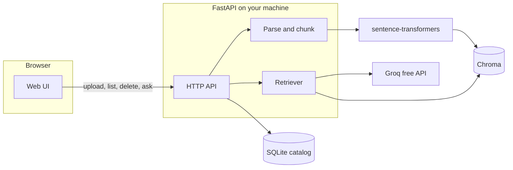

# rag-docs-assistant

[](https://github.com/taha080/rag-docs-assistant/actions/workflows/ci.yml)

Ask questions about your own documents and get an answer that points back to the passage it came from. Embeddings are computed on your machine. The only network call in the question path is to Groq's free API, and you can paste that key into the browser instead of putting it on the server.

## Overview

Retrieval-augmented generation (RAG) answers a question from your files rather than from the model's memory alone.

1. You upload a PDF, text file, or Markdown file.
2. The app reads the text, splits it into overlapping passages, and keeps the page number for PDFs.
3. A local sentence-transformers model (`all-MiniLM-L6-v2` by default) turns each passage into a vector. No embedding API is called.
4. Chroma stores those vectors on disk. A SQLite catalog remembers the file name, size, and passage count.
5. When you ask a question, the same local model embeds the question, Chroma returns the nearest passages, and those passages are sent to Groq with the question.
6. The response includes the model's answer and the passages that were retrieved: file name, page (when the file has pages), chunk index, the text, and a relevance score.

The citations are the retrieved passages. The model is also told to mention those labels, and to say when the excerpts do not contain the answer.

This is a single-user local app. It does not have accounts. Scanned PDFs with no text layer are not read, because there is no OCR step.

## Features

- Upload PDF, TXT, and Markdown, including `.markdown`.
- List and delete documents. Deleting removes the file, the catalog row, and the vectors.
- Chat-style questions with citations (file, page, chunk, excerpt, relevance).
- Groq API key from `GROQ_API_KEY` or from the browser. A key typed into the page is stored in `sessionStorage` for that tab, sent on the `X-Groq-Api-Key` header, and never written to the database or the logs.
- Health check that reports whether a server key is configured, without revealing the key.
- Chunking that respects page boundaries and overlaps neighboring passages.
- Configurable model, chunk size, overlap, and how many passages are retrieved.
- Offline pytest suite (Groq and the embedding model are faked) and a GitHub Actions workflow.
- Optional Dockerfile and `render.yaml`. Local `uvicorn` is the setup this project is built around.

## Architecture



The browser and the API are the same origin. FastAPI serves the HTML, CSS, and JavaScript from `app/static/`.

## Tech stack

| Piece | Choice |
| --- | --- |
| API and UI | FastAPI, served with uvicorn. Plain HTML, CSS, and JavaScript. |
| Language model | Groq's OpenAI-compatible chat completions API. Default model: `openai/gpt-oss-20b` (free tier). |
| Embeddings | `sentence-transformers`, model `all-MiniLM-L6-v2`, on CPU. |
| Vectors | Chroma persistent client, cosine space. |
| Catalog and uploads | SQLite for metadata, files under `data/uploads/`. |
| PDF text | `pypdf`. |
| Tests | pytest, `httpx.MockTransport`, an in-process lexical embedder. |

PyTorch is pinned to the CPU wheel in `requirements.txt`. The default PyPI torch wheel pulls in a large CUDA stack that this app does not use.

## Local setup

Requires Python 3.11 or newer.

```bash
python -m venv .venv
source .venv/bin/activate   # Windows: .venv\Scripts\activate
pip install -r requirements.txt -r requirements-dev.txt
cp .env.example .env
```

Put your Groq key in `.env` if you want the server to hold it, or leave `GROQ_API_KEY` empty and paste the key into the page later.

```bash
uvicorn app.main:app --host 127.0.0.1 --port 8000 --reload
```

`make run` does the same thing. Open [http://127.0.0.1:8000](http://127.0.0.1:8000). Interactive API docs are at [http://127.0.0.1:8000/docs](http://127.0.0.1:8000/docs).

The first upload downloads `all-MiniLM-L6-v2` from Hugging Face (about 90 MB). No Hugging Face account is required. Later runs use the local cache.

### Configuration

Environment variables and `.env` use the same names. An empty value is ignored, so a blank `GROQ_API_KEY=` means "no server key".

| Variable | Default | Purpose |
| --- | --- | --- |
| `GROQ_API_KEY` | empty | Server-side key. Optional when the browser sends one. |
| `GROQ_MODEL` | `openai/gpt-oss-20b` | Chat model id. |
| `GROQ_BASE_URL` | `https://api.groq.com/openai/v1` | API root. |
| `GROQ_TIMEOUT_SECONDS` | `60` | HTTP timeout. |
| `GROQ_MAX_COMPLETION_TOKENS` | `1024` | Cap on the completion. |
| `GROQ_TEMPERATURE` | `0.5` | Sampling temperature. |
| `GROQ_REASONING_EFFORT` | `low` | Sent only for gpt-oss models, to keep free-tier token use down. |
| `GROQ_INCLUDE_REASONING` | `false` | Ask Groq not to return the reasoning trace. |
| `EMBEDDING_MODEL` | `all-MiniLM-L6-v2` | Local sentence-transformers model name. |
| `CHROMA_PERSIST_DIR` | `./data/chroma` | Chroma directory. |
| `UPLOAD_DIR` | `./data/uploads` | Original files. |
| `SQLITE_PATH` | `./data/catalog.db` | Document catalog. |
| `CHUNK_SIZE` | `800` | Maximum characters per passage. |
| `CHUNK_OVERLAP` | `120` | Characters repeated from the previous passage. Must be smaller than `CHUNK_SIZE`. |
| `TOP_K` | `4` | Passages sent to the model. A request can override this from 1 to 10. |
| `MAX_UPLOAD_BYTES` | `10485760` | Upload limit, 10 MB. |
| `LOG_LEVEL` | `INFO` | Python log level for the `rag_docs` logger. |

Changing `EMBEDDING_MODEL` after documents have been indexed requires deleting the `data/` directory and uploading again. Vectors from two models are not comparable.

## Getting a free Groq key

Groq's free tier does not ask for a credit card. The paid Developer plan is separate. Stay on the free plan.

1. Create an account at [https://console.groq.com](https://console.groq.com).
2. Open [https://console.groq.com/keys](https://console.groq.com/keys) and create a key. It starts with `gsk_`.
3. Either set `GROQ_API_KEY` in `.env`, or paste the key into the field in the web UI.

The UI keeps the key in `sessionStorage` for the current tab. Closing the tab drops it. Forget clears it immediately. The browser sends it as `X-Groq-Api-Key` on each question. It is not placed in the query string, so it does not show up in a normal access log. The server does not store it, and log lines that happen to contain a `gsk_` key are redacted. Validation errors omit the submitted body so a bad request cannot echo the key back.

Free-tier limits are low (on the order of 30 requests per minute and a small token budget for the gpt-oss models). The current numbers are on [Groq's rate limits page](https://console.groq.com/docs/rate-limits). The default model is `openai/gpt-oss-20b` because it is on that free tier and answers quickly. `openai/gpt-oss-120b` and `qwen/qwen3.8-27b` are other free-tier options. Set `GROQ_MODEL` if you want one of them. `reasoning_effort` and `include_reasoning` are only sent for model ids that contain `gpt-oss`, because other models reject those fields.

`llama-3.1-8b-instant` and `llama-3.3-70b-versatile` are not on the free plan anymore. Leave the default, or pick one of the free ids above.

## Usage

1. Start the server and open the site.
2. Paste a Groq key if the health stamp does not say a server key is configured.
3. Drop a PDF, `.txt`, `.md`, or `.markdown` file into the library. `examples/linden-orchard.md` is a short original note you can use.
4. Ask a question. The answer card lists each retrieved passage. Open a citation to read the excerpt.
5. Delete a document from the library when you are done with it. The chat transcript itself lives only in the page.

Try, with the sample file: "When is the Linden orchard harvested?" The citation should be the harvest passage, and the answer should mention the second Saturday of October.

### curl

```bash
curl -s http://127.0.0.1:8000/api/health

curl -s -F "file=@examples/linden-orchard.md" http://127.0.0.1:8000/api/documents

curl -s http://127.0.0.1:8000/api/documents

curl -s -X POST http://127.0.0.1:8000/api/query \
  -H "Content-Type: application/json" \
  -H "X-Groq-Api-Key: $GROQ_API_KEY" \
  -d '{"question": "When is the Linden orchard harvested?"}'

curl -s -X DELETE http://127.0.0.1:8000/api/documents/DOCUMENT_ID
```

You can send the key in the JSON body as `api_key` instead of the header. The header wins when both are present. If neither is present, the server uses `GROQ_API_KEY`.

## API reference

All JSON errors use this shape:

```json
{ "error": "missing_api_key", "message": "Human readable explanation." }
```

### `GET /api/health`

```json
{
  "status": "ok",
  "version": "1.0.0",
  "embedding_model": "all-MiniLM-L6-v2",
  "llm_model": "openai/gpt-oss-20b",
  "groq_configured": false,
  "document_count": 0
}
```

`groq_configured` is true when `GROQ_API_KEY` is non-empty. The key itself is not included.

### `POST /api/documents`

Multipart upload. The field name is `file`. PDF, TXT, and Markdown only. The extension is what counts, not the browser's MIME type.

`201` returns:

```json
{
  "id": "uuid",
  "filename": "notes.md",
  "content_type": "text/markdown",
  "size_bytes": 1200,
  "chunk_count": 3,
  "created_at": "2026-10-25T12:00:00+00:00"
}
```

| Status | `error` | When |
| --- | --- | --- |
| 400 | `missing_filename` | The upload has no file name. |
| 400 | `empty_document` | The file is empty or has no extractable text. |
| 400 | `unreadable_file` | The PDF is damaged or encrypted, or the text is not UTF-8. |
| 400 | `too_many_chunks` | The file splits into more than 5000 passages. |
| 413 | `file_too_large` | Above `MAX_UPLOAD_BYTES`. |
| 415 | `unsupported_file_type` | Anything other than PDF, TXT, or Markdown. |
| 500 | `embedding_error` or `vector_store` | The local model or Chroma failed. |

### `GET /api/documents`

Returns a JSON array of the same document objects, newest first.

### `DELETE /api/documents/{document_id}`

`204` with an empty body. `404` `not_found` when the id is missing or not a UUID.

### `POST /api/query`

```json
{
  "question": "When is harvest?",
  "api_key": "optional, prefer the header",
  "top_k": 4
}
```

Header: `X-Groq-Api-Key: gsk_...`

`200` returns:

```json
{
  "answer": "Harvest is the second Saturday of October. [linden-orchard.md chunk 1]",
  "model": "openai/gpt-oss-20b",
  "sources": [
    {
      "document_id": "uuid",
      "filename": "linden-orchard.md",
      "page": null,
      "chunk_index": 1,
      "text": "Harvest is the second Saturday of October...",
      "score": 0.71,
      "label": "linden-orchard.md chunk 1"
    }
  ]
}
```

`page` is a 1-based PDF page, or `null` for text and Markdown. `score` is `1 - cosine distance`, clamped to 0–1, higher meaning closer. `label` is the citation string.

| Status | `error` | When |
| --- | --- | --- |
| 400 | `missing_api_key` | No header, no JSON key, and no `GROQ_API_KEY`. |
| 400 | `invalid_api_key` | The key is longer than 500 characters. |
| 400 | `no_documents` | The library is empty. |
| 400 | `no_matches` | The index returned nothing. |
| 422 | `validation_error` | The question is empty or too long, or `top_k` is out of range. The response does not include the submitted body. |
| 502 | `llm_error` | Groq rejected the key, rate limited the request, timed out, or returned an empty answer. |

`GET /` serves the UI. `GET /docs` is the generated OpenAPI UI.

## Testing

The suite does not call Groq and does not download the embedding model. Questions are embedded with a small hashing embedder so shared words rank together, and Chroma is the real persistent library in a temporary directory.

```bash
pytest
```

`make test` is the same command. GitHub Actions runs that on every pull request and on pushes to `main`, with `HF_HUB_OFFLINE=1` so a test that accidentally loads the real model fails instead of downloading it.

## Deployment

Running on your own computer is the intended deployment. The index is a folder of files, and the embedding model wants more memory than a small free container usually has.

### Docker

```bash
docker build -t rag-docs-assistant .
docker run --rm -p 8000:8000 --env-file .env rag-docs-assistant
```

The image installs the CPU build of PyTorch, runs as a non-root user, and checks `GET /api/health`. The first upload still downloads the embedding model into the container's Hugging Face cache unless you mount a cache directory.

### Render

`render.yaml` is a blueprint for a free Docker web service. It expects you to set `GROQ_API_KEY` in the Render dashboard (`sync: false`, so the value is not committed). Two limits matter:

- Free instances are small, often 512 MB of RAM. Importing PyTorch and loading MiniLM can exceed that, so the process may be killed on boot or on the first upload.
- The free disk is ephemeral. Uploads, the SQLite catalog, and the Chroma index disappear when the instance restarts or is spun down.

Check [Render's current free-plan limits](https://render.com/docs/free) before you rely on it. If the instance cannot stay up, use the local server.

## Project structure

```
app/
  main.py                 FastAPI app, static files, error handlers
  config.py               Environment settings
  schemas.py              Request and response models
  domain.py               Document and citation records
  citations.py            "file p.N chunk M" labels
  redact.py               Scrubs gsk_ keys from logs and errors
  errors.py               Errors that map to HTTP status codes
  api/                    /api/health, /api/documents, /api/query
  ingest/                 Filename checks, PDF and text parsing, chunking
  services/               Embeddings, Chroma, SQLite, Groq, RAG orchestration
  static/                 Browser UI
examples/linden-orchard.md
tests/                    Offline pytest suite
.github/workflows/ci.yml
Dockerfile
render.yaml
requirements.txt          Runtime dependencies, CPU torch
requirements-dev.txt      pytest
```

## Troubleshooting

- **Missing API key.** The question returns `missing_api_key`. Paste a key or set `GROQ_API_KEY`, then restart uvicorn if you changed `.env`.
- **Groq says the model does not exist.** The id in `GROQ_MODEL` is retired or not on your plan. Use `openai/gpt-oss-20b`.
- **429 from Groq.** The free tier is out of requests or tokens for the moment. Wait and try again. Fewer and shorter documents stay inside the token budget more easily.
- **Upload says there is no extractable text.** The PDF is probably a scan. Export a text-based PDF, or paste the text into a `.txt` file.
- **Embedding model failed to load.** The first run needs network access to Hugging Face. After that, the cache is enough.
- **Vector dimension error after changing models.** Delete the `data/` directory and upload the documents again.

## License

MIT. Copyright (c) 2026 Taha Ahsan. See [LICENSE](LICENSE).
